  <!-- Dynamic Typing Header in Signature Emerald -->
  

  <!-- Animated Botanical Systems Dock -->
  

    
  

  <!-- Badges -->
  

    
    &nbsp;
    
    &nbsp;
    
    &nbsp;
    
  

---

### 👨‍💻 About Me

I am a **2nd Year Computer Science & Engineering student** at **Amal Jyothi College of Engineering** (Class of 2029) based in Kerala, India. I engineer software across **edge AI, computer vision, autonomous robotics, and stochastic simulation engines**—building from hardware and physical constraints up.

* 🤖 **Autonomous Robotics & Edge AI:** On-device ThermalNet YOLO human detection (<20ms latency) on Qualcomm RB5, off-grid LoRa peer-to-peer telemetry meshes, and ROS 2 autonomous navigation for campus electric vehicles.
* 🏎️ **Simulation & Systems:** Vectorized 10,000-pass Monte Carlo race strategy engines, non-linear physical degradation modeling, and offline-first mobile architectures in Kotlin.
* 🌐 **Tactile Web & Graphics:** Hardware-accelerated 60 FPS Canvas 2D/WebGL engines, custom physics components, and fluid interactive interfaces.

---

### 🚀 Selected Projects

| Project | Focus | Description | Live / Repo |
| :--- | :--- | :--- | :--- |
| **Phoenix X** | `Edge AI` `Robotics` | Autonomous Search & Rescue Micro-UAV with ThermalNet YOLOv8 & 5km off-grid LoRa mesh *(SIH 2026 Shortlisted)* | [Cockpit ↗](https://phoenix-sar-uav.vercel.app) · [Overview ↗](https://jvstin47.github.io/projects.html#p8) |
| **F1 Monte Carlo** | `Python` `NumPy` `FastF1` | Vectorized 10,000-run stochastic race strategy optimizer with dynamic programming pit windows | [Live App ↗](https://f1-monte-carlo-race-strategy-simula.vercel.app) · [Code ↗](https://github.com/jvstin47/f1-monte-carlo-race-strategy-simulator) |
| **Team Stellar** | `ROS 2` `Autonomous EV` | Dual-mode autonomous electric campus buggy with LiDAR, RTK-GPS, and computer vision | [Website ↗](https://jvstin47.github.io) |
| **AroggyaGram-3** | `AI Agents` `Next.js` | Intelligent community health crisis triage & dispatch network *(Winner ACM Vibefest & BIRAC/MakerHub)* | [Code ↗](https://github.com/jvstin47/AroggyaGram-3) · [Case Study ↗](https://jvstin47.github.io/projects.html#p1) |
| **Captain Lakshmi** | `Canvas 2D` `React 19` | Editorial historical monograph scrubbing 3,100+ archival frames at 60 FPS | [Live Site ↗](https://capt-lakshmi.vercel.app) · [Code ↗](https://github.com/jvstin47/Captain-Lakshmi-Invicta) |
| **AutoMeter** | `Flutter` `IoT Transit` | Smart fare meter with dynamic on-screen UPI QR payment generation | [Code ↗](https://github.com/jvstin47/AutoMeter) |
| **Opportunity** | `Kotlin` `Jetpack Compose` | Offline-first Android task scoring ecosystem with Wear OS companion | [Code ↗](https://github.com/jvstin47/opportunity-android-task-planner) |
| **Song Chord Analyzer** | `PyTorch` `Electron` | Local MIR desktop pipeline with Demucs v4 stem separation & BTC Transformer | [Code ↗](https://github.com/jvstin47/Song-Chord-Analyzer--Mac) |

---

### 🛠️ Tech Stack

  

---

### 📊 GitHub Activity

  
  &nbsp;
  

---

   
  <pre><code>┌──[jvstin47@stellar-node]─[~]
└──$ echo $PHILOSOPHY
"Resilient by default. Zero bloat. Engineered for high stakes."</code></pre>
   

