<div align="center">

  # Justin Joe Mathew
  <p><b>Computer Science Undergrad · Amal Jyothi College of Engineering ('29)</b></p>
  <p>Focusing on computer vision, edge systems, and autonomous robotics.</p>

  <!-- Animated Interactive Portfolio Deck (SVG) -->
  <p align="center">
    
  </p>

  <!-- Quick Action Badges -->
  <p align="center">
    <a href="https://jvstin47.github.io/47/" target="_blank">
      
    </a>
    &nbsp;
    <a href="https://github.com/jvstin47" target="_blank">
      
    </a>
    &nbsp;
    <a href="https://www.linkedin.com/in/jvstin47/" target="_blank">
      
    </a>
    &nbsp;
    <a href="./assets/Justin_Mathew_Resume.pdf" target="_blank">
      
    </a>
  </p>

</div>

---

### ⚡ Quick Status

```bash
$ justin --status
⚡ Location:    Kerala, India
🎓 Education:   2nd Year B.Tech CSE @ Amal Jyothi College of Engineering (Class of 2029)
🛠 Focus:       Computer Vision · Edge Systems · Autonomous Robotics
🚀 Active Work: Phoenix X (SIH '26 Shortlist) · F1 Monte Carlo Strategy Sim
```

---

### 👨‍💻 About Me

I’m currently in my 2nd year of Computer Science & Engineering at **Amal Jyothi College of Engineering** in Kerala, India. Most of my work centers around **edge devices, computer vision, and autonomous systems**.

I enjoy building things that bridge software with physical hardware—whether that's aerial search-and-rescue systems architecture, edge AI inference, or high-throughput stochastic simulation engines.

---

### 🚀 Selected Projects

<details open>
<summary>🛰️ <b>Phoenix X — Autonomous Search & Rescue UAV</b> <i>(SIH 2026 Shortlisted)</i></summary>
<br/>

> Autonomous Micro-UAV engineered for disaster zones with communication blackouts. Handles on-device thermal object detection and offline peer-to-peer telemetry over LoRa.
>
> **Stack:** Computer Vision · ThermalNet YOLO · LoRa P2P · Python  
> **Links:** [Mission Cockpit ↗](https://phoenix-sar-uav.vercel.app) · [Project Overview ↗](https://jvstin47.github.io/47/projects.html#p8)

</details>

<details>
<summary>🏎️ <b>F1 Monte Carlo Race Strategy Simulator</b></summary>
<br/>

> Vectorized 10,000-pass Monte Carlo race strategy engine that models non-linear tyre wear curves and uses dynamic programming to evaluate optimal pit-stop windows against live FastF1 telemetry.
>
> **Stack:** Python · NumPy · FastF1 · React  
> **Links:** [GitHub Code ↗](https://github.com/jvstin47/f1-monte-carlo-race-strategy-simulator)

</details>

<details>
<summary>🚑 <b>AroggyaGram-3 — Community Crisis Triage Network</b> <i>(ACM Vibefest & BIRAC Ideathon Winner)</i></summary>
<br/>

> Intelligent community health dispatch system that parses unstructured emergency requests, classifies urgency, and routes nearby responders.
>
> **Stack:** Next.js · TypeScript · AI Triage Logic  
> **Links:** [GitHub Code ↗](https://github.com/jvstin47/AroggyaGram-3) · [Case Study ↗](https://jvstin47.github.io/47/projects.html#p1)

</details>

<details>
<summary>📜 <b>Captain Lakshmi: Invicta — Scroll-Driven Monograph</b></summary>
<br/>

> Interactive historical archive scrubbing 3,100+ frames at 60 FPS using hardware-accelerated Canvas 2D to commemorate Dr. Lakshmi Sahgal.
>
> **Stack:** Canvas 2D · React 19 · Vite  
> **Links:** [Live Site ↗](https://capt-lakshmi.vercel.app) · [GitHub Code ↗](https://github.com/jvstin47/Captain-Lakshmi-Invicta)

</details>

<details>
<summary>🛺 <b>AutoMeter — Dynamic UPI Fare Meter</b></summary>
<br/>

> Smart auto-rickshaw meter prototype that tracks distance and dynamically displays UPI QR codes for passenger cashless payment.
>
> **Stack:** Flutter · Android Native · IoT  
> **Links:** [GitHub Code ↗](https://github.com/jvstin47/AutoMeter)

</details>

<details>
<summary>📱 <b>Opportunity — Offline-First Task Planner</b></summary>
<br/>

> Native Android task architecture prototype built with Room DB and background WorkManager synchronization.
>
> **Stack:** Kotlin · Android Native · Room DB  
> **Links:** [GitHub Code ↗](https://github.com/jvstin47/opportunity-android-task-planner)

</details>

<details>
<summary>🎵 <b>Song Chord Analyzer — Desktop Music Transcription</b></summary>
<br/>

> Local MIR desktop application with Demucs v4 audio stem separation and BTC Transformer chord recognition. Built with [@jerinjomy07](https://github.com/jerinjomy07).
>
> **Stack:** PyTorch · Electron · CUDA  
> **Links:** [GitHub Code ↗](https://github.com/jvstin47/Song-Chord-Analyzer--Mac)

</details>

---

### 🛠️ Tech Stack

<div align="center">

  <a href="https://skillicons.dev">
    
  </a>

</div>

---

### 📊 GitHub Activity

<div align="center">

  
  &nbsp;
  

</div>
